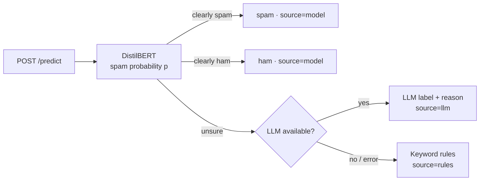

<div align="center">

# 📧 spam-filter-api

**A spam filter API with an LLM second opinion, measured honestly: the simple model won, and the explanations showed why the big one fails** ♡

<a href="https://github.com/namita-tj/spam-filter-api/actions/workflows/ci.yml"></a>


[What it is](#-what-it-is) · [Why](#-why) · [Results](#-results) · [Quick start](#-quick-start) · [How it works](#-how-it-works) · [Can and can't](#-what-it-can-and-cant-do) · [Files](#-where-to-find-what)

</div>

### 🤔 What it is
A spam filter you can call over HTTP. A fine-tuned DistilBERT decides first. When it's unsure, an LLM gives a second
opinion, and if no LLM is available, keyword rules decide. It can also show which words drove each decision. It runs
live on Azure, deployed automatically from GitHub. (It used to be called *Email-Filtering-Using-DistilBERT*,
until the results showed DistilBERT wasn't the model to keep.)

Around it is the part I care about most: a benchmark against simpler models and a local LLM, a test on modern
emails it never saw, and tests of whether its explanations can be trusted.

**For:** anyone building a text classifier who wants to know whether the big model is worth it, and anyone looking for
a small but complete example of an ML API in production.

### ✨ Why
This started as a small project: fine-tune DistilBERT, put it behind an API, ask an LLM when unsure. When I came back
to it, I realised I had never checked whether any of that was worth it.

**Why this matters:** a spam filter that flags real email is worse than one that misses some spam, because nobody
checks the spam folder for the invoice, the job offer or the message from the bank. A model that scores 99% on its
test set can still fail on email from today. And if a model explains its decision, the explanation has to be true,
or it only makes a wrong answer look convincing. So I measured three things: is the transformer better than a
simple model, does the LLM fallback help, and can I believe the explanations?

### 📈 Results
The same 2,000 Enron-Spam test emails, and 2,000 modern emails (769 phishing, 1,231 safe) that no model was trained on.

| Model | Enron F1 | Enron: real emails flagged | Modern: real emails flagged | ms per email | Training |
| --- | ---: | ---: | ---: | ---: | ---: |
| Naive Bayes | 0.990 | **0.8%** | 23.2% | 0.6 | 16 s |
| Logistic regression (TF-IDF) | 0.986 | 1.9% | **22.6%** | 0.4 | 18 s |
| DistilBERT, fine-tuned | **0.992** | 0.9% | 37.4% | 10.4 | 27 min |
| Qwen2.5-3B, zero-shot (200 + 200 emails) | 0.817 | 46.9% | 74.4% | ~500 | none |

**In short:**
- On Enron, every trained model is at about 0.99 F1. DistilBERT isn't better, just 20 to 30 times slower.
- On modern email, they all still catch over 99% of the phishing, but they flag a quarter or more of the real email.
  DistilBERT is the worst at 37%.
- **Why:** the explanations showed the words pushing hardest towards "not spam" were *enron*, *vince*, *kaminski*: the
  model learned "looks like Enron = safe".
- The LLM fallback never fired. On modern email the model wasn't unsure, it was confidently wrong.

Every model, all 17 KPIs I set *before* training (9 passed, 3 missed) and the explanation tests are in
[`reports/`](reports): [KPIs](reports/kpis.md), [benchmark](reports/benchmark.md), [explainability](reports/explainability.md).

<p align="center"></p>
<p align="center"><sub>A real explanation from the model. Red words pushed it towards spam, blue towards ham.</sub></p>

### 🚀 Quick start
**Try the live API** (the link is in the repo's About section). The first request after a quiet period takes a minute
or two while the model loads.

```bash
curl -X POST "https://<live-url>/predict?explain=true&top_k=3" \
  -H "Content-Type: application/json" \
  -d '{"subject": "Account locked", "text": "Verify your password within 24 hours."}'
```

The answer gives the label, the spam probability, which stage decided (`model`, `llm` or `rules`) and, if you asked,
the words that mattered most. `GET /health` shows whether the model is loaded and the LLM fallback is on.

**Run it yourself** (Python 3.12 or 3.13):

```bash
git clone https://github.com/namita-tj/spam-filter-api && cd spam-filter-api
cp .env.example .env
docker compose up --build             # or: pip install -r requirements.txt, then uvicorn app.main:app --reload
```
Then open http://localhost:8000/docs.

**Reproduce the results** on Google Colab (free T4 GPU, no API key needed):
[`notebooks/train_and_evaluate.ipynb`](notebooks/train_and_evaluate.ipynb) trains the model and measures every KPI
(about 40 minutes), and [`notebooks/benchmark.ipynb`](notebooks/benchmark.ipynb) runs the comparison (about 15 minutes).

<details>
<summary><b>🖥️ Train and evaluate locally</b></summary>

```bash
pip install -r requirements.txt -r training/requirements.txt
python -m training.train              # fine-tune DistilBERT on Enron-Spam
python -m evaluation.run --phishing   # all KPIs (add --no-llm to skip API calls)
python -m training.benchmark --local-llm Qwen/Qwen2.5-3B-Instruct   # the comparison, needs PyTorch
```
`TRAIN_LIMIT=2000` gives a quick trial run, and `python -m training.baseline` trains the TF-IDF baseline in under a
minute on a CPU.
</details>

### 🔧 How it works



The "unsure" band is chosen on the validation set, so that whatever the model decides alone is at least 99% precise.
Explanations use Integrated Gradients, which measures how much each word moved the probability. I didn't use
attention weights, because they show where the model looks, not what changes its mind.

**What's different from a typical spam-filter project:**

| Typical project | This one |
| --- | --- |
| Trains one model and reports its accuracy | Compares it with Naive Bayes, SVM, logistic regression and a local LLM, on the same emails |
| Tests on its own test set | Also tests on modern emails no model has seen |
| Shows explanations and trusts them | Tests whether they are faithful, and audits them for shortcut words |
| Picks the goals after seeing the results | 17 KPIs with targets written down before training |
| Runs on a laptop | Runs on Azure, set up as code, deployed from GitHub without a stored password |

<details>
<summary><b>☁️ How it runs on Azure</b></summary>

Everything is code in [`infra/main.bicep`](infra/main.bicep); the step-by-step setup is in
[`docs/deploy-azure.md`](docs/deploy-azure.md).

- **Container Apps** runs the Docker image from GitHub Container Registry and scales to zero, so it costs next to nothing.
- **Blob Storage** holds the model. The app downloads it with its own managed identity, and the storage account accepts no keys.
- **Secrets** live in the container app's encrypted store. Container Apps *express* environments don't support Key Vault references, so the template stores them in the app.
- **Application Insights** records every request with its latency, label, source and probability.
- **GitHub Actions** deploys every merge to `main` and runs a smoke test against the live URL. It signs in through OpenID Connect, so no Azure password is stored in GitHub.
- **A budget alert** and a log cap keep costs in check.
</details>

<details>
<summary><b>⚙️ Configuration</b></summary>

Everything is set through environment variables; [`.env.example`](.env.example) lists them all.

| Variable | What it does |
| --- | --- |
| `MODEL_DIR` | Folder with the trained model (default `spam_detection_model`) |
| `MODEL_BLOB_URL` | Azure Blob folder to download the model from if `MODEL_DIR` is empty |
| `S3_BUCKET`, `S3_PREFIX` | Same from S3, if `MODEL_BLOB_URL` is not set |
| `APPLICATIONINSIGHTS_CONNECTION_STRING` | Sends traces, latency and prediction logs to Application Insights |
| `LLM_PROVIDER` | `azure`, `openai` or `none`; picked from the credentials if empty |
| `AZURE_OPENAI_ENDPOINT`, `AZURE_OPENAI_API_KEY`, `AZURE_OPENAI_DEPLOYMENT` | Azure OpenAI fallback |
| `OPENAI_API_KEY`, `OPENAI_MODEL` | OpenAI fallback (default `gpt-4o-mini`) |
| `LOW_THRESHOLD`, `HIGH_THRESHOLD` | Override the unsure band from training |
| `LLM_TIMEOUT_SECONDS`, `LOG_LEVEL` | LLM timeout and log level |
</details>

### ✅ What it can and can't do
| Works well | Not yet |
| --- | --- |
| Catching spam and phishing (over 99%, old and new) | Leaving modern real email alone: 37% flagged, because it trained on Enron only |
| Explaining which words drove a decision | Fully faithful explanations: removing the top 5 words barely beats removing 5 random ones |
| An LLM second opinion when the model is unsure | Catching data that has changed: the model is confidently wrong there, so the LLM never gets asked |
| Running live on Azure for almost no cost | Fast first requests: a cold start takes a minute or two |

### 💡 What I learned
- **Bigger isn't automatically better.** Naive Bayes trains in 16 seconds and flags fewer real emails than DistilBERT. If I shipped this today, I'd put logistic regression or Naive Bayes behind the same API.
- **A confidence threshold can't protect you from changed data.** The model wasn't unsure about modern email, it was confidently wrong.
- **Test the explanations too.** The shortcut audit was the most useful part of the project: it's what exposed the Enron bias.
- **Write the goals down first.** Setting 17 KPIs before training meant I couldn't move the goalposts afterwards.

### 📚 Where to find what
| I want to… | Look here |
| --- | --- |
| see every result, KPI and explanation test | [`reports/`](reports) |
| set it up on Azure | [`docs/deploy-azure.md`](docs/deploy-azure.md), [`infra/main.bicep`](infra/main.bicep) |
| reproduce the results | [`notebooks/`](notebooks) |
| read the API: decision chain, explanations, LLM fallback | `app/` |
| read the training and the benchmark | `training/` |
| read the KPIs, faithfulness tests and shortcut audit | `evaluation/` |
| run the tests | `pip install -r requirements-dev.txt`, then `ruff check .` and `pytest --cov` |

Every push runs lint and the tests (coverage has to stay above 80%) without a GPU or API keys. Every merge to `main`
builds the Docker image and deploys it to Azure.

**Data:** trained on [Enron-Spam](https://huggingface.co/datasets/SetFit/enron_spam) (Metsis et al., 2006), about
31,700 training and 2,000 test emails, with 10% held out for validation. Modern test emails come from the
[Phishing Email Detection](https://huggingface.co/datasets/zefang-liu/phishing-email-dataset) dataset (LGPL-3.0) and
are only used for testing.

### 🌱 What's next
Retraining on a mix of Enron and recent email, sending emails that look unlike the training data to the LLM, trying a
7–8B open model with a few examples in the prompt, and running Integrated Gradients with more steps.

<div align="center"><sub>build cool things that actually work ♡</sub></div>
